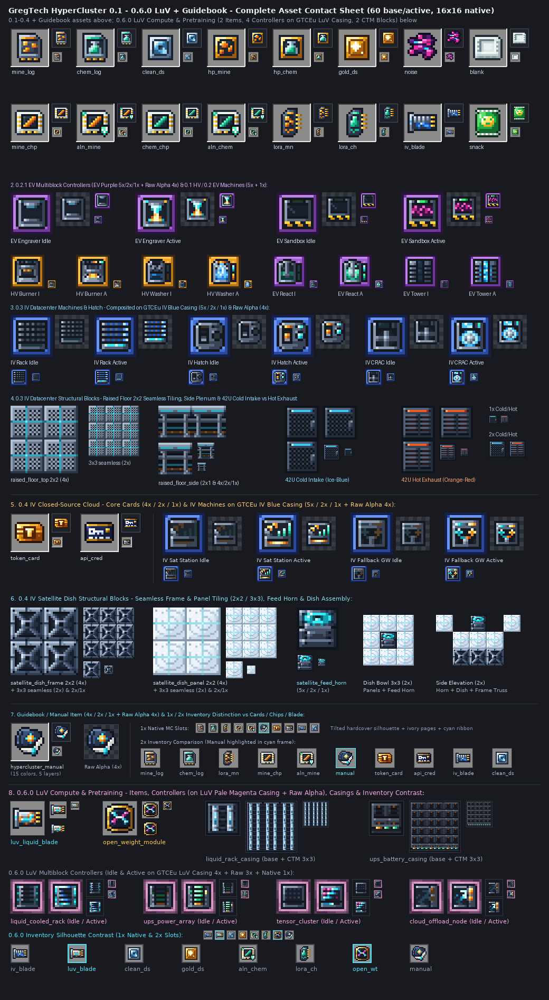
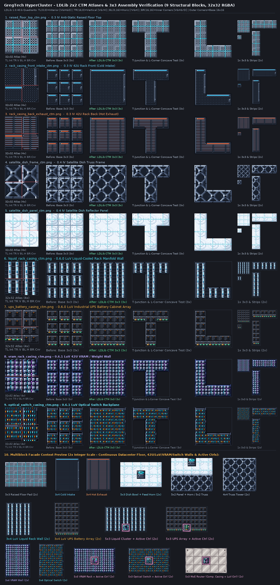
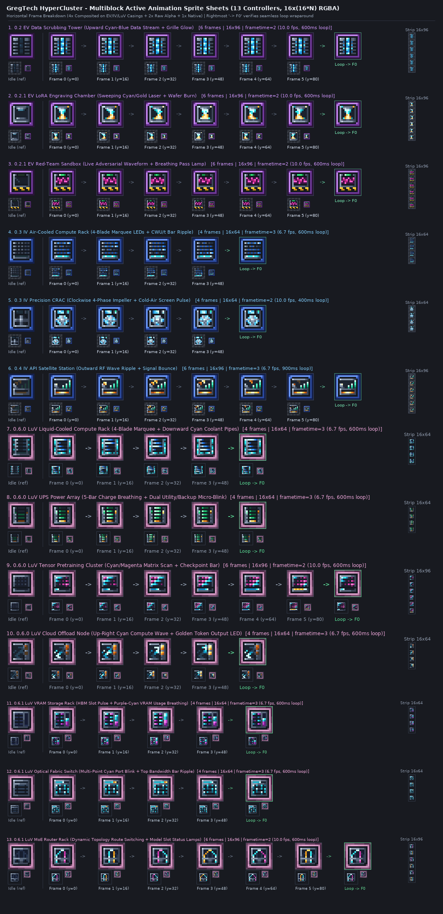

# GregTech HyperCluster

GregTech CEu Modern 的 Minecraft 1.20.1 Forge 附属模组。首版范围和开发顺序见[实施计划](IMPLEMENTATION_PLAN.md)，贴图和分层源文件见[资源清单](Public/README.md)。

## 开发环境

| 组件 | 版本 |
| --- | --- |
| Minecraft | 1.20.1 |
| Forge | 47.4.0 |
| GTCEu Modern | 7.4.0 |
| LDLib / Registrate / Configuration | 1.0.40.b / MC1.20-1.3.11 / 2.2.0 |
| Java（Gradle、编译和游戏） | 17 |
| Java（NeoFormRuntime 生成开发产物） | 21 |
| Gradle Wrapper / ModDevGradle | 8.10 / 2.0.91 |
| Parchment | 1.20.1-2023.09.03 |

工程基于 [GTCEu 1.20.1 官方模板 19cc903](https://github.com/GregTechCEu/1.20.1-Addon-Template/tree/19cc9032b50b378033f95e1e8e0de1ab4e3bf062)。模组 ID 为 `hypercluster`，Java 包为 `dev.hypercluster`。

在项目根目录执行以下命令。环境脚本优先使用 `.tools/jdk-17`，也接受指向 Java 17 JDK 的 `JAVA_HOME`。Java 21 可放在 `.tools/jdk-21`，也可通过 `HYPERCLUSTER_JDK_21` 指定。Gradle 则可通过 Foojay 自动下载缺少的工具链。IDE 可导入 `build.gradle` 并选择 Java 17 作为 Gradle JVM。

bash/zsh：

```bash
source ./env.sh
./gradlew runData
./gradlew build
./gradlew runClient
./gradlew runGametest
```

fish：

```fish
source env.fish
./gradlew runData
./gradlew build
./gradlew runClient
./gradlew runGametest
```

资源生成输出在 `src/generated/resources/`，构建产物在 `build/libs/`。首次构建会下载 Gradle 和开发依赖。在启用命令的测试世界里可用 `/give @s hypercluster:mining_telemetry_log` 验证物品注册和模型。`runGametest` 以 headless 方式跑全部回归（Forge GameTestServer，目前 **92** 个用例，覆盖物品/配方、P02 结算探针、P03/P04 闭环与边界、P05/P06 生存配方存在性、0.2 EV 数据工坊全链、0.2.1 微调与红队对齐链、0.3 IV 智算机房全链、0.4 IV 闭源云全链、0.5 视觉与结构、0.6 系列 LuV 智算/拓扑/模型注册表/机房总线、0.6.3 音效注册与 MoE 发光大屏）。

> **`runGametest` 环境要求（0.4 起）**：`run/gametest/server.properties` 须为 `level-type=minecraft\:flat`（gametest 场地固定在 y=-60，`normal` 世界会在其上方生成天然岩层，遮挡 0.4 卫星站的馈源露天校验）；且 gametest 世界在多次运行之间持久化，重跑前建议删除 `run/gametest/world` 以清掉历史残留结构与账本状态。

开发客户端、专服和数据生成分别使用 `run/client/`、`run/server/`、`run/data/`，日志写入各自的 `logs/`。运行 `./gradlew runServer` 首次启动时，Minecraft 会生成 `run/server/eula.txt`。确认同意其中链接的 EULA 后，在该文件设 `eula=true` 并再次启动。

## 持续集成

`.github/workflows/ci.yml` 有两个 job，第一个是合并门禁；`.github/workflows/release.yml` 负责 tag 发版。

| 触发时机 | job | 做什么 |
| --- | --- | --- |
| PR / `main` 推送 | **`validate`**（`main` 的必需检查） | Ubuntu + Java 17，用仓库自带的 `./gradlew`：`runData` → 生成资源漂移检查 → `spotlessCheck` → `build` → 全新平坦世界的 `runGametest`。通过后上传 JAR 与 SHA-256；失败时上传 Gradle 控制台日志、游戏日志与崩溃报告。 |
| 手动触发（`workflow_dispatch`） | `client-smoke` | 使用独立游戏目录在 Xvfb 中启动客户端。实际渲染主菜单后保存截图和日志，最后清理本次进程。 |
| 推送 `v*` tag | **`release`**（发版） | 先校验 tag 名 == `v{gradle.properties 的 mod_version}`（不一致直接失败），然后完整复跑 validate 全部门禁 + Xvfb 客户端冒烟，全绿后创建 GitHub Release：上传同一趟构建的主 JAR 与 `SHA256SUMS.txt`（不带 `-sources`），`v0.*` 或含 `-` 的 tag 自动标记为 pre-release，并自动生成 Release Notes（存在对应验收报告时附链接）。 |

`main` 已设分支保护：`validate` 为必需检查，禁止强推与删分支。本地验证过——故意让 `spotlessCheck` 失败的 PR 会被判 `FAILURE` 并 `BLOCKED`。

### 运行与排障

- **`| tee` 会吞掉失败。** GitHub 默认 shell 是 `bash -e {0}`，**没有 `pipefail`**，`gradle | tee` 报的是 `tee` 的退出码（永远是 0）。第一版因此让一次 `spotlessCheck` 失败显示成绿色、PR 仍可合并。凡是把 Gradle 输出 `tee` 出去的步骤，都必须显式 `shell: bash` + `set -o pipefail`。
- **首次启动与主菜单。** 空白游戏目录默认打开辅助功能引导页。冒烟脚本预写 `onboardAccessibility:false`，用 `ALSOFT_DRIVERS=null` 让 OpenAL 在无音频设备的 runner 上初始化，再等待 Forge 首次实际渲染 `TitleScreen` 的标记。等待失败也会尝试截图，便于定位当时的界面。
- **先生成，再单独打包。** `runData` 与 `build` 是两次独立调用；生成后比对 `src/generated/resources` 的已跟踪改动**和新文件**，有漂移就失败。这样「同一次调用把旧生成资源打进包里」不可能再发生。
- **发版 tag 先对版本。** Release 工作流第一步就读 `gradle.properties` 的 `mod_version` 并要求 tag 恰好是 `v{mod_version}`；tag 打错分支或忘了 bump 版本会在跑任何 Gradle 之前失败。Release 附件来自同一趟构建（先 `sha256sum` 生成 `SHA256SUMS.txt`），不存在「验过的 jar 和传上去的 jar 不是同一份」的问题。
- **每轮全新平坦世界。** CI 自己写 `run/gametest/server.properties`（`level-type=minecraft\:flat`）和 `eula.txt`；`run/` 既被 gitignore 也不进缓存。除了退出码，还要在日志里确认确实跑了测试批次、`GAME TESTS COMPLETE`、以及 `All N required tests passed`；N 从日志读，新增用例不用改 workflow。

> 日志时间戳随 locale 变（`[28Nov2026 …]` / `[2811月2026 …]`），CI 里的匹配一律只锚定消息文本，不用时间戳。

本地可在配置好 Java 17、Xvfb 和 ImageMagick 后运行 `bash .github/scripts/client-smoke.sh run/validation/client-smoke`。脚本为每次运行创建独立游戏目录。

## 0.1.0 内容与支持范围

- **物品**：`mining_telemetry_log` 矿处遥测日志、`blank_carrier` 空白载体、`mining_edge_chip` 矿处边缘芯片（均可堆叠 64，带中英工具提示）。
- **机器**：`hv_micro_burner` HV 微型烧录台、`hv_telemetry_ore_washer` HV 遥测示范洗矿机（SimpleTieredMachine HV）。
- **配方**（JEI 可查，全部 `hypercluster` 命名空间）：
  - 烧录：1 日志 + 1 空白载体 + HV 电力 → 1 芯片（`micro_burner` 类型）；
  - 遥测洗矿类型 `telemetry_ore_washing`：镜像基础洗矿（破碎铜矿石 + 电路1 + 1000mB 水 → 纯净破碎铜矿石 + 石粉 ± 1/3 钴粉）与芯片省水版（电路2 + 芯片不消耗 + **100mB 水**，产物一致）；
  - 生存合成：空白载体（聚乙烯板+硅晶圆+HV电路 ×2）、微型烧录台（HV 机壳/发射器/电路/线缆/玻璃）、遥测洗矿机（**原版 hv_ore_washer** + HV 传感器/电路/线缆/玻璃）。
- **精确结算**：软化排除堵仓/取消/断电未完/空转（0.1 份日志），仅在输出真实落槽后每批 +1 日志；64 容量持久化缓冲（GUI 只取槽、满仓丢弃并提示、拆除返还、存档重载不翻倍）。
- 完整生存流程见 [docs/survival_walkthrough_0.1.md](docs/survival_walkthrough_0.1.md)；各阶段验收见 [docs/reports/](docs/reports/P05_P06_release_report.md)。

## 0.2 核心内容（EV 数据工坊）

- **新增物品**（均堆叠 64 + 中英工具提示）：`chemical_telemetry_log` 化工遥测日志、`clean_dataset` 清洁数据集、`high_purity_mining_dataset` / `high_purity_chemical_dataset` 高纯领域数据集、`corrupted_noise` 乱码噪点、`chemical_edge_chip` 化工边缘芯片。
- **新增机器**：`ev_telemetry_chemical_reactor` EV 遥测示范化学反应釜（SimpleTieredMachine EV，复用基类 `TelemetryMachine` 与 `TelemetryRecipeLogic` 的 IO.OUT 精确结算，禁 Mixin）；`data_scrubbing_tower` 数据清洗塔（GT 固定结构多方块，0.5 起为 5×9×5 阶梯收腰分馏塔：洁净不锈钢基座 + 洁净玻璃塔身 + 中央钛管道核心柱 + 格栅散热顶帽，输入/输出总线、流体输入仓、能源仓、维护仓置于底座）。
- **配方**（全部 `hypercluster` 命名空间，JEI 可查）：
  - `telemetry_chemical_processing`：镜像 GTCEu 7.4.0 实配 `chemical_reactor/indium_concentrate_separation`（600 EU/t × 50t，电路#1，4 铝粉 + 1000mB 铟浓缩液 → 小堆铟粉 + 4 亚硫酸铝粉 + 1000mB 铅锌溶液）与芯片版（电路#2 + 芯片不消耗，**辅助铝粉减半 4→2**，产物种类数量不变）；
  - `data_scrubbing`：1 原始日志（矿处/化工）+ 1000mB 蒸馏水 + EV 电力 → 1 高纯领域数据集 + 1 清洁数据集 ± 90% 乱码噪点；乱码噪点 ×4 + 250mB 蒸馏水 → 1 硅粉（所有输出可处理）；
  - 微型烧录台扩展：高纯化工数据集 + 空白载体 → 化工边缘芯片；高纯矿处数据集 + 空白载体 → 矿处边缘芯片（128 EU/t × 64t，比原始日志版**能耗 1/4、耗时 1/2**）；
  - 生存合成：清洁数据集可替代日志位置合成空白载体 ×2；EV 化工反冲炉（消费原版 gtceu:ev_chemical_reactor）；数据清洗塔主控（EV 机壳 + EV 电路 ×2 + 玻璃 + 钛板）。
- **验收**：`./gradlew runData`、`build`、`runGametest`（29/29）全绿；渲染态同步注册覆盖全部 4 台机器并由回归断言（防 0.1 贴图不同步复发）；详细报告见 [docs/reports/0.2_core_acceptance_report.md](docs/reports/0.2_core_acceptance_report.md)。

## 0.2.1 内容（微调与红队对齐）

- **新增物品**（均堆叠 64 + 中英工具提示）：`golden_dataset` 黄金标注样本、`mining_lora_card` / `chemical_lora_card` 领域 LoRA 卡、`aligned_mining_edge_chip` / `aligned_chemical_edge_chip` 已对齐边缘芯片（美术正式贴图已接入）。
- **清洗塔副产扩展**：两条清洗配方在 9/10 乱码噪点之外，以 **1/10** 追加副产黄金标注样本。
- **新增机器**（EV 固定多方块，0.2.1 初版共用 3×3×3 舱室，0.5 起分别改为 7×5×5 刻录舱与 7×6×7 红队舱）：
  - `lora_engraving_chamber` 神经微调刻录舱（配方类型 `lora_engraving`）：高纯领域数据集 + 空白载体 + 黄金样本 + 500mB 蒸馏水 + EV 电力 → 对应领域 LoRA 卡；
  - `red_team_sandbox` 沙盒红队测试舱（配方类型 `red_team_testing`）：2× 乱码噪点（对抗样本）+ 普通边缘芯片 → **已对齐边缘芯片**。
- **电路 `#3` LoRA 专精配方**（不消耗 LoRA 卡，与 `#1/#2` 严格隔离）：洗矿机稀有副产钴粉概率 **1/3 → 2/3**；化反在同量 2 铝粉下**小堆铟粉翻倍**（铝守恒 2→2）。
- **电路 `#4` 已对齐芯片收益**（受控、无恶性幻觉炉渣）：不消耗已对齐芯片，化反 600→**450 EU/t**、洗矿 16→**12 EU/t**（均降 **25%**），产物与基准一致，界面工具提示标明已通过红队对抗校验。
- **0.2 三处修正**：清洁数据集载体配方产量 2→**4**；中文文案统一「化学反应釜」并说明烧录台双样本输入；芯片省料配方亚硫酸铝输出 4→**2**（铝守恒）。
- **验收**：`runData` / `build`（`gregtech-hypercluster-0.2.1.jar`）/ `runGametest`（35/35）全绿，Xvfb 客户端冒烟零内容报错；报告见 [docs/reports/0.2.1_acceptance_report.md](docs/reports/0.2.1_acceptance_report.md)。

## 0.3 内容（IV 自建算力：风冷智算机房 Tier I–II）

- **新增结构方块**：`raised_floor` 防静电架空地板（顶/底 `raised_floor_top`、四侧 `raised_floor_side`）、`rack_casing_intake` 42U 进风面外壳、`rack_casing_exhaust` 42U 出风面外壳。
- **新增物品**：`iv_compute_blade` IV 风冷计算刀片（每枚 6 CWU/t）、`green_snack_pack` 绿色零食包彩蛋（机柜零食槽 -5% 总耗电，`-Dhypercluster.snackBonus=false` 可关）。
- **Tier I 风冷算力机柜 `air_cooled_compute_rack`**：固定结构 3×5×2 多方块（进风面外墙 + 出风面外墙 + 标准能源仓/维护仓 + **GTCEu 原生算力传输仓**，无需 PCB 冷却液）。最多插 4 枚刀片（0→24 CWU/t 线性），实现 `IOpticalComputationProvider` 直连 GT 光学管道：同 tick 严格算力预算（`simulate=true` 只查询不扣减、多消费者共享预算、断缆/低电/未维护/无刀片归零并记录降额原因）。
- **Tier II 精密空调 `precision_crac`**：3×3×1 多方块，运行中机组（8 格内）+ 架空地板下铺 + 进/出风通道未堵 → 机柜机房升级 Tier II：PUE 1.80 → **1.45**（`总耗电 = IT 耗电 + 基础制冷耗电 × 环境系数 × 气流系数`；冰原/雪山/深海或 Y<20 制冷 -40%，下界/热沙漠 ×2）。机房重算由结构变化/邻近更新事件触发 + 40 tick 有界校验，禁止每 tick 全图扫描。
- **推理协处理器仓 `iv_inference_hatch`**：可挂载在数据清洗塔上的 IV 级多方块仓室（GT 原生算力接收链路 + 推理芯片槽）。对白名单（`hc_inference_boost` 标签）配方：普通边缘芯片 2 CWU/t → EU/t -25%，已对齐芯片 8 CWU/t → EU/t -50%；CWU/t 逐 tick 真实计费，断算/拔芯片自动回退原规则（不白嫖、不卡死）。
- **零 HPCA 死锁**：全部 0.3 生存配方只用 GTCEu 7.4.0 原版 IV 可直接获取材料（钢/橡胶/铜/不锈钢/铝/硅晶圆/铂导线/IV 电路/IV 传感器/IV 机身 + 原版纸/糖/染料），由 GameTest 断言不含任何 HPCA 组件或科研站/数据仓/算力传输仓产物。
- **验收**：`runData` / `build`（`gregtech-hypercluster-0.3.0.jar`）/ `runGametest`（44/44，含 8 个 0.3 机房用例：刀片线性、预算竞争、降额归零、光学链路喂科研站、HPCA 共存、存档重载、PUE Tier 升降、推理仓真实消耗与断算回退）全绿，Xvfb 客户端冒烟零内容报错；报告见 [docs/reports/0.3_acceptance_report.md](docs/reports/0.3_acceptance_report.md)。

## 0.4 内容（IV 闭源云：API 卫星地面站 + Token 账本 + 计费契约 + 兜底网关）

- **新增结构方块**：`satellite_dish_frame` 卫星站钢架、`satellite_dish_panel` 抛物面反射面板、`satellite_feed_horn` 高频馈源接收头。
- **新增物品**：`api_credential_card` API 凭证卡（对地面站控制器右击绑定玩家 UUID，插入凭据槽开立/操作账户）、`token_credit_card` Token 充值晶卡（NBT 整数余额，站内整额存取）。
- **服务端 Token 账本 `CloudTokenLedger`**（SavedData，主世界存储、跨站跨维度共享）：按世界存档内玩家 UUID 独立 `long` 账户；首次在任意卫星站开户自动发放**一次性 5,000,000 体验 Token**（跨站/跨维度/跨重启严格一次）；付费调用以**唯一订单 ID** 三态结算（预扣 HELD → 完成 SETTLED / 取消精确退还 REFUNDED），余额不足拒绝启动、失败/取消不吞单不双扣。
- **API 卫星地面站 `api_satellite_station`**：固定多方块（0.5 起 5×6×5 桁架高塔 + 5×5 抛物面大锅），**LV/MV 能源仓即可驱动**；馈源须**露天直视天空**（遮挡拒联机，雨 ×1.5 / 雷暴 ×2.0 信号衰减，`Y>120` 小幅延迟/费率优化）；高纯数据集自动出售换整数 Token（50,000/份）。本地模拟闭源服务（1 清洁数据集 → 1 高纯矿处数据集）完整计费：
  - **Prompt Caching**：键 `(playerUuid, machinePos, recipeId, modelId, tier)`，连续第 2 轮起 Token 费率 **10%**，任一维度变化立即失效重算；
  - **Batch**：耗时 ×2、账单 ×0.5，与缓存**乘法叠加**（缓存 + 批处理 = **5%**）；
  - **档位** Medium（×1 单价 ×1 耗时 30 EU/t）/ Extra High（×2 单价 ×0.5 耗时 120 EU/t）；
  - **429 并发限流**：累计消费定账户 Tier 1–5 → 1–5 并发，超限暂停且不计费；
  - **Leaving Soon 生命周期**：模型按游戏日倒计时（`-Dhypercluster.legacyRetireDay`），倒计时内仍可用，**到期拦截不计费**。
- **本地 Fallback 兜底网关 `local_fallback_gateway`**：IV 级被动部件；429 / Token 缺额 / 型号下线时自动切换**本地降速兜底**（耗时 ×4、Token 零计费）继续完成任务，产线不硬卡死。
- **零 HPCA 死锁**：0.4 生存配方 15 种成分全部为 GTCEu 7.4.0 原版 IV 可直接获取（GameTest 断言）。
- **验收**：`runData` / `build`（`gregtech-hypercluster-0.4.0.jar`）/ `runGametest`（56/56，含 11 个 0.4 云用例 + 生存扩展）全绿，Xvfb 客户端冒烟零内容报错；0.4 正式贴图（`Public/` 9 张 + Aseprite 源）已直接接入；报告见 [docs/reports/0.4_acceptance_report.md](docs/reports/0.4_acceptance_report.md)。

## 0.5 内容（视觉与结构升级：大型非火柴盒多方块 + 运行态粒子 + 动画贴图）

- **修复 Tooltip 重复 Bug**：GTCEu 的 `MetaMachineBlock#appendHoverText` 会自动插入 `<modid>.machine.<name>.tooltip` 描述行；此前注册时又显式 `.tooltips()` 同一 key，导致物品栏 / EMI 悬停中文描述显示两遍。已移除全部 11 台机器的显式重复项（描述仍由 GTCEu 自动插入），并新增 GameTest 回归 `machineDescriptionTooltipsNotDuplicated`（描述恰好出现 1 次 + 全部行无重复）。
- **4 座多方块重塑为大型非火柴盒异形结构**（全复用 GTCEu 原版方块 + 0.4 CTM 卫星方块，零 Mixin）：
  - `data_scrubbing_tower` → **5×9×5 阶梯收腰分馏塔**：底部 5×2×5 洁净不锈钢机械方块基座（主控在第 2 层正面人眼高度，标准仓室置于底座）；中段收窄为 3×5×3 四面洁净玻璃塔身，中心贯通 1×5×1 钛管道核心柱，外围四角独立钛框架立柱 + 上下水平环梁；顶部 5×2×5 扩口散热顶帽（格栅环绕）。
  - `lora_engraving_chamber` → **7×5×5 横向龙门光学洁净间**：底层 7×1×5 纯白无尘室塑凝土平台，中央嵌入过滤格栅刻录载台；前后大面积无尘室玻璃；顶部外露式钛框架龙门横梁，控制器即中央悬空刻录柱。
  - `red_team_sandbox` → **7×6×7 八边形切角防爆穹顶**：四角切空呈八边形轮廓，深灰固态钢 + 坚固机械方块外壳与外露钢框架防撞肋条；四面 3×2 宽幅强化防爆玻璃观察窗；内部中空，中央孤立一座隔离测试台座（四周留 1 格隔离气隙），顶部阶梯收口。
  - `api_satellite_station` → **5×6×5 桁架高塔 + 5×5 抛物面大锅**：底部 3×3 钢架底座承载主控、LV/MV 能源仓与维护仓（复用 `satellite_dish_frame` CTM）；上部 5×5 凹面抛物反射锅（`satellite_dish_panel` CTM）阶梯收成碗形；中心高挑立起 `satellite_feed_horn` 馈源（顶部保持 100% 露天校验）。
- **全部 6 座多方块新增纯客户端 WORKING 粒子反馈**（`animateTick`，仅在客户端且机器处于 WORKING 渲染态时触发，零服务端 TPS 开销）：清洗塔钛管道周围有上升的青色微粒和末地烛光点；刻录舱悬空刻录柱向下射出青/金微粒光束；红队舱隔离台座四周紫红传送门/洋红火花；卫星站馈源向高空发射青/琥珀上升光点脉冲；机柜出风面与 CRAC 冷通道吹出轻量白色/冰蓝气流。
- **6 组多帧动画 `overlay_front_active.png` + `.png.mcmeta` 正式接入**（Public/ 交付同步至 `src/main/resources`，frametime 2–3）。
- **GameTest**：结构模板场地扩宽为 15×12×15（容纳 7×6×7 穹顶、双站点并排与 9 层高塔），塔、两舱、卫星站与光学管路均按新结构测试。57 项回归通过，Xvfb 冒烟通过贴图、模型与 CTM 加载检查。[0.5 验收报告](docs/reports/0.5_acceptance_report.md)

升级旧存档后，以上四座机器需要按 0.5 的结构预览重新搭建才能成型。

## 0.6.0–0.6.2 内容（LuV 智算 → 机房拓扑 → 物理总线与光缆）

- **0.6.0 · LuV 智算与训练**：`liquid_rack_casing` / `ups_battery_casing` 结构方块（原生 LDLib CTM）、`luv_liquid_blade` / `open_weight_module` 物品；`liquid_cooled_compute_rack`（5×5×3，4 刀片 0→64 CWU/t，PUE **1.20**，**冷却液是真实输入**：每 tick 喝 1 mB 蒸馏水或 PCB 冷却液，断液 20 tick 容错后归零）、`ups_power_array`（5×4×3，满 4,000,000 EU，**60 s 备电**）、`tensor_pretraining_cluster`（7×6×7 阶梯收腰，2400 t 训练，**每 25% 落 NBT Checkpoint**，OOM 显存闸门，UPS 保护续训）、`cloud_offload_node`（LuV 部件，租富余算力折算 Token）。
- **0.6.1 · 机房拓扑 + TB 显存 + 模型注册表**：`vram_rack_casing` / `optical_switch_casing`（原生 CTM）、`iv_hbm_module`(4 TB) / `luv_hbm_module`(16 TB) / `jailbreak_card` 物品；`vram_storage_rack`（5×5×3，4 槽）、`optical_fabric_switch`（5×4×3，聚合 128 CWU/t，超限 **503 + 300 ticks**）、`moe_router_rack`（5×5×5，部署槽 + 4 LoRA + DeepThink）；`AIModelDefinition` / `AIModels` 运行时注册表，**10 台模型**分 `LOCAL` / `API` 两阵营（本地占显存零 Token，API 零本地显存计 Token）。
- **0.6.2 · 物理总线与光缆网络**：批量物料改走 GTCEu 原生 `IMPORT_ITEMS` / `EXPORT_ITEMS`；刀片、HBM、权重、LoRA 等驻留硬件经支持 Forge 物品能力的**机房硬件仓**装卸，旧存档装仓口即可取回已装载硬件。底座必须压在同一片正交连通、同高、无缺口的矩形架空地板上（短边 ≥5、长边 ≤24、长宽比 ≤3:1）。跨房及对外用算走原生算力传输仓 + 连续光学管道 + 原生算力接收仓，**断链归零**。

## 0.6.3 内容（8 组音效 + MoE 6×6 鲸娘发光大屏）

### 音效

8 个程序化合成的工业音效全部接入（mono 44100 Hz Ogg Vorbis，归一至 −14 LUFS，真峰值 ≤ −1.2 dBTP）：

| 音效 | 绑定 | 类型 |
| --- | --- | --- |
| `datacenter_air_hum` | `air_cooled_compute_rack` | 工作循环 |
| `datacenter_liquid_hum` | `liquid_cooled_compute_rack` | 工作循环 |
| `pretraining_cluster` | `tensor_pretraining_cluster` | 工作循环 |
| `satellite_uplink` | `api_satellite_station` | 工作循环 |
| `laser_burn` | `hv_micro_burner`、`lora_engraving_chamber` | 工作循环 |
| `red_team_scan` | `red_team_sandbox` | 工作循环 |
| `rack_click` | 机柜/硬件仓插拔刀片、HBM、权重、LoRA，及路由状态切换 | 单次 |
| `terminal_alert` | 429 限流（卫星站）、503 拥塞（光交换）、OOM（MoE 路由）、冷却断供（液冷机柜）、UPS 切备电（备电阵列） | 单次（同机 ≥60 tick 节流） |

**实现要点**：

- 由配方驱动的 4 台机器（micro burner、LoRA 舱、红队舱、预训练集群）通过 `GTRecipeType#setSound` 走 **GTCEu 原生 `RecipeLogic#updateSound`** 机制，机器停止/卸载时由框架自动停播。
- 运行 `DUMMY_RECIPES` 的 3 台机器（风冷柜、液冷柜、卫星站）其"工作"是 tick 契约而非配方，`RecipeLogic` 永远不会报告 working，因此改用 **同一个 `AutoReleasedSound` 类**显式驱动，谓词与 GTCEu 自身守卫一致（`!isInValid()`、方块已加载、同一台机器仍在原位），并遵守 GT 的机械音效开关与消音升级。客户端静音（Blocks 音量归零）安全工作，因为从不直接触碰音频设备。
- `sounds.json` 由 GTCEu 自带的 `SoundEntryBuilder.SoundEntryProvider` 在 `runData` 中生成，**注册表与 JSON 不可能漂移**。
- `terminal_alert` 的 5 个触发源统一走 `MachineAlerts.play(...)`，每台机器各持一个 `lastAlertTick` 时间戳，**同机 60 tick 内只响一次**——429 反复重试、OOM 每 tick 复检、冷却液断供/回补抖动都不会变成警报风暴。
- `rack_click` 挂在部署槽与 4 个 LoRA 槽的 `onContentsChanged` 上，覆盖手动、管道与 AE2 三种插拔路径；路由状态切到 LOADING/ONLINE/EVICTED 时也会响。

### MoE 路由器 6×6 发光大屏

- **`5×5×5` 结构完全未改动**——屏幕是纯客户端四边形，不加方块，现有 `TopologyTests` 与全部存档不受影响。
- 贴图 `whale_maid_screen_96.png` 为 **96×96**；横跨 **6×6 方块**、16 px/格，即**一像素一纹素 1:1 还原**，无任何过滤。
- 屏幕居中悬停于机柜顶框上方 0.75 格，随控制器前向自动旋转覆盖东南西北四向；以 `LightTexture.FULL_BRIGHT` 提交，配合 `entityCutoutNoCull` **双面可见且透明边缘不画黑框**，在无光机房与夜间均可读。
- **点亮条件**：多方块已成型 + 有供电 +（部署任意 `DeepSeek-V6767` 系列模型 **或** 主控 GUI 打开"展示大屏"开关）。断电或拆毁自动熄灭。
- `getRenderBoundingBox` 覆盖整块 6×6 悬浮区域，避免玩家偏视时被视锥剔除；`shouldRenderOffScreen` 保证它不随控制器所在的区块段一并剔除。
- 主控 GUI 新增该开关（`MachineUiTests` 零重叠检测通过）。

### 素材许可

代码遵循根目录 [LICENSE.MD](LICENSE.MD)（**LGPL-3.0**）；AI 生成的工业贴图与音效素材（含 MoE 发光大屏贴图）遵循 [Public/ASSETS_LICENSE.md](Public/ASSETS_LICENSE.md)（**CC0 1.0 Universal**）。

> 发光大屏贴图 `whale_maid_screen_96.png` 的原始参考图由 OpenAI Image 生成，96×96 像素画由 Gemini + Aseprite MCP 绘制，无外部第三方作者，与其他 AI 生成贴图和音效一并适用 CC0 1.0。

## 素材预览

### 方块与物品接触表



### 原生 CTM 连接纹理



### 机器运行态动画帧



### MoE 大屏贴图


## 运行锁定组合（P06 实测）

| 组合 | 版本 | 状态 |
| --- | --- | --- |
| Forge 专服（生产 jar） | Forge 47.4.0 + GTCEu 7.4.0 官方分发包 + 本模组 0.1.0 | 专服冷启动至 `Done`，零 ERROR（`run/pv-gt`） |
| 上述 + AE2 | AE2 15.4.12（**Modrinth/GitHub 构建**）+ GuideME 20.1.15 | 专服冷启动至 `Done`，零 ERROR（`run/pv-ae2`） |

> 注意：modmaven.dev 上的 `appeng:appliedenergistics2-forge:15.4.12` 与官方发布物不是同一构建，其 mixin 在 Forge 生产环境会崩溃；取包请走 Modrinth/GitHub 或核对 sha256（详见发布报告）。
